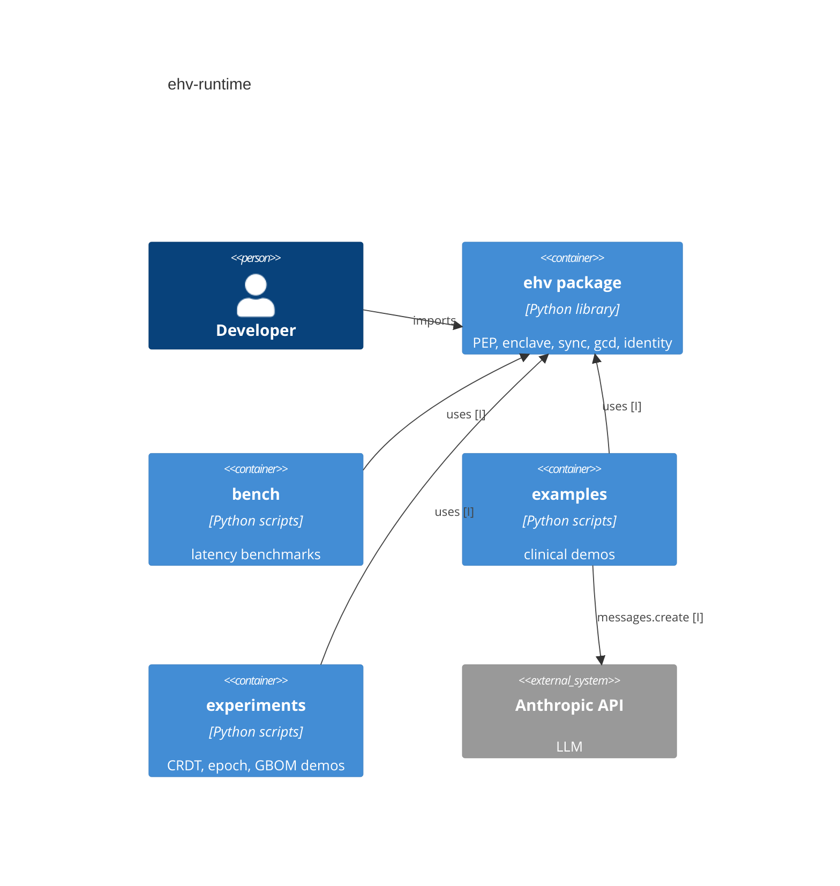
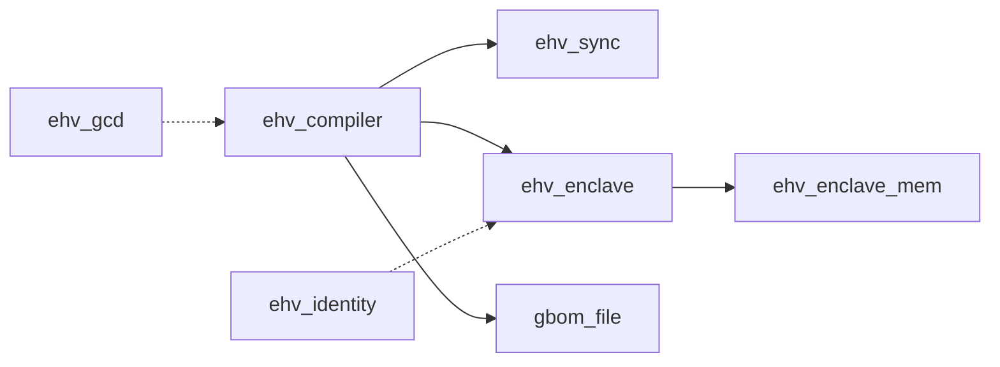
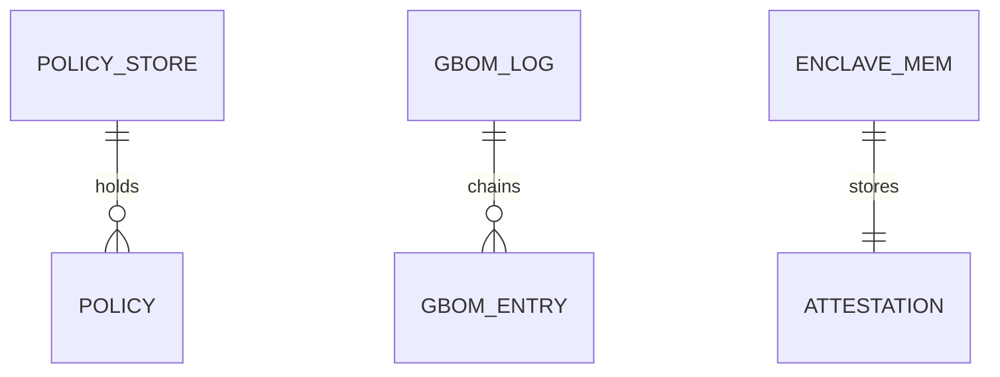

# Technical Architecture

## First-principles core

- Every governed action passes one decision point that outputs PERMIT, DENY or ESCALATE (ehv/compiler/engine.py:113) [C]
- Policy must be attested in a current epoch or the call is denied (ehv/compiler/engine.py:131) [C]
- Every decision is appended to a hash-chained log (ehv/compiler/gbom.py:125) [C]
- Assumption: the enclave is a simulation, not real TEE hardware (ehv/enclave/enclave.py:8) [I]

## Containers (C4 L2)

Source: pyproject.toml:6, examples/anthropic_redteam.py:97 [I]

## Components (C4 L3)

Source: ehv/compiler/engine.py:5, ehv/compiler/engine.py:6, ehv/enclave/enclave.py:47 [C]

### ehv.compiler (PEP engine + GBOM log)
`ckb:component:ehv/compiler`
Hosts EHVEngine and the GBOM log; imports sync and enclave (ehv/compiler/engine.py:15) [C]

### ehv.enclave (simulated TEE)
`ckb:component:ehv/enclave`
Attests policy hashes; uses shared memory ehv_enclave_mem (ehv/enclave/enclave.py:8) [C]

### ehv.gcd (grammar-constrained decoding)
`ckb:component:ehv/gcd`
DFA and grammar masking of logits (ehv/gcd/dfa.py:24) [C]

### ehv.identity (SPIFFE SVID stub)
`ckb:component:ehv/identity`
SVIDManager with TTL and revocation (ehv/identity/workload.py:25) [C]

### ehv.sync (CRDT policy store)
`ckb:component:ehv/sync`
LWW PolicyStore and causal variant (ehv/sync/store.py:7) [C]

## Data model

Source: ehv/sync/store.py:28, ehv/compiler/gbom.py:125, ehv/enclave/enclave.py:20 [I]

- Policies: in-memory, timestamped. Lifecycle: updated only by newer timestamp (ehv/sync/store.py:28) [C]
- GBOM entries: appended per decision, exported as OSCAL file (ehv/compiler/gbom.py:127) [C]
- Enclave memory: shared memory segment ehv_enclave_mem (ehv/enclave/enclave.py:20) [C]

## Interfaces

### EHVEngine.enforce decorator
`ckb:interface:library:provides:{"name":"ehv.compiler.engine.EHVEngine.enforce"}`
Library decorator wrapping actions (ehv/compiler/engine.py:113) [C]

### mask_logits
`ckb:interface:library:provides:{"name":"ehv.gcd.masker.mask_logits"}`
Library function masking disallowed tokens (ehv/gcd/masker.py:23) [C]

### SVIDManager
`ckb:interface:library:provides:{"name":"ehv.identity.workload.SVIDManager"}`
Library class for workload identity (ehv/identity/workload.py:25) [C]

No HTTP routes, events or RPC are served. [C]

## Dependencies

- pandas, matplotlib: optional, for bench plots (pyproject.toml:25) [C]
- Anthropic API: downstream, used only by the red-team example (examples/anthropic_redteam.py:97) [I]

## Configuration reference

- ANTHROPIC_API_KEY: env, secret, red-team example (examples/anthropic_redteam.py:94) [C]
- Enclave secret_key: hardcoded simulated root key, secret (ehv/enclave/enclave.py:24) [C]
- epoch_duration default 60s; SVID TTL default 3600s (ehv/compiler/engine.py:58, ehv/identity/workload.py:43) [C]
- EHV.cfg: TLC model constants only, no runtime keys [?]

## Deployment

Python package built with setuptools and Makefile (pyproject.toml:6) [I]. No CI, IaC or deploy target was found. [?]

## Non-functional posture

- Security: fail-closed, hardcoded simulated key (ehv/enclave/enclave.py:24) [C]
- Compliance/PHI: clinical examples use synthetic dosage only (examples/clinical_dosage.py:11) [I]
- Performance: measured by bench/measure_enforcement.py:122 [C]
- Reliability: LWW convergence after partition (experiments/crdt_convergence.py:53) [I]
- Observability: GBOM audit log (ehv/compiler/gbom.py:125) [C]
- Testing: pytest suite covers engine, gbom, enclave, sync and gcd (tests/test_engine.py:1) [C]
- Formal verification: EHV.tla checked with TLC, mirroring PERMIT, DENY, ESCALATE (EHV.tla:77) [I]
- The ehv/sync/vclock.py vector clock module was not scanned. [?]
