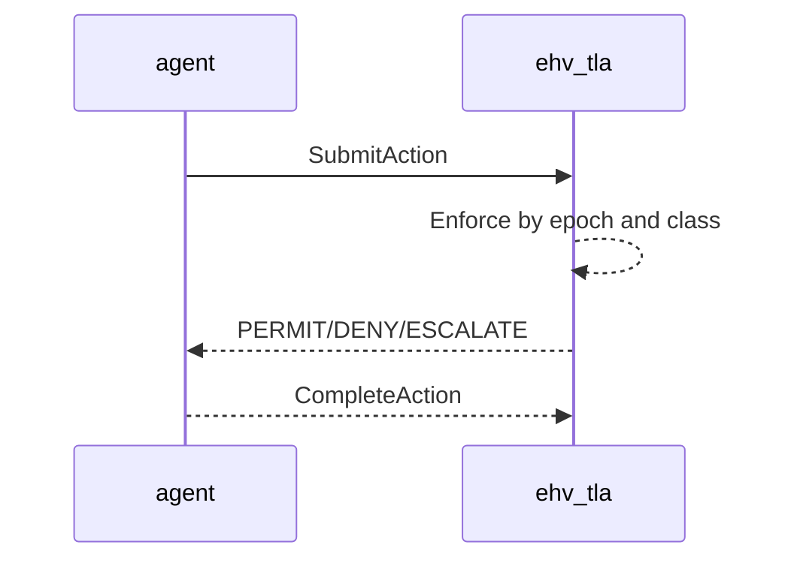
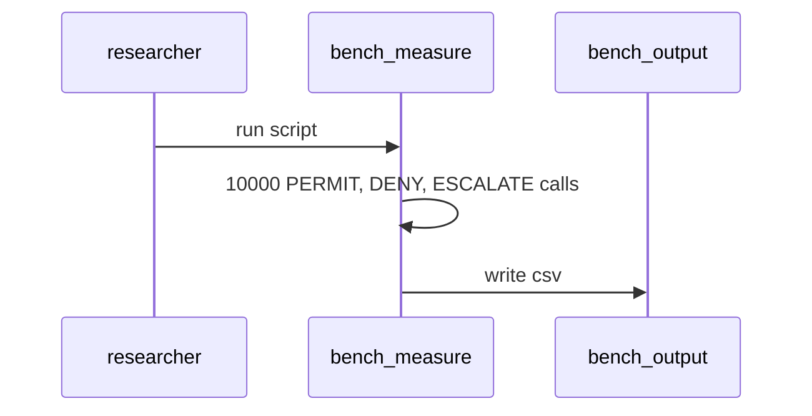
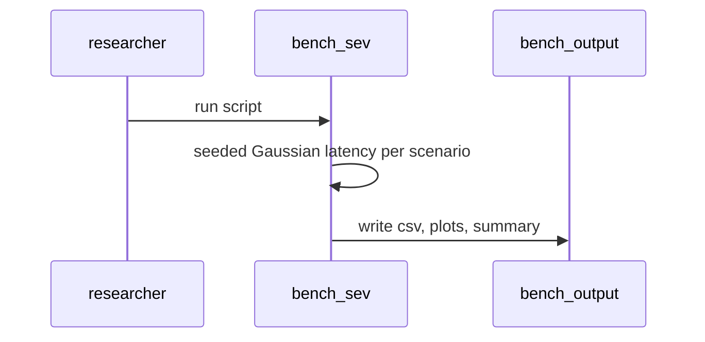
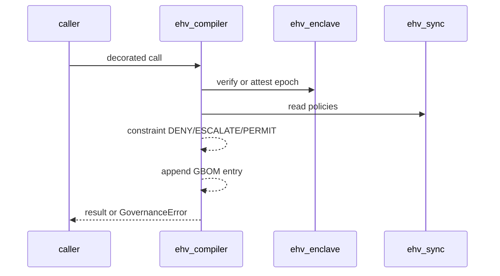
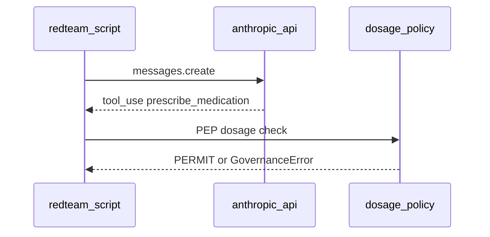
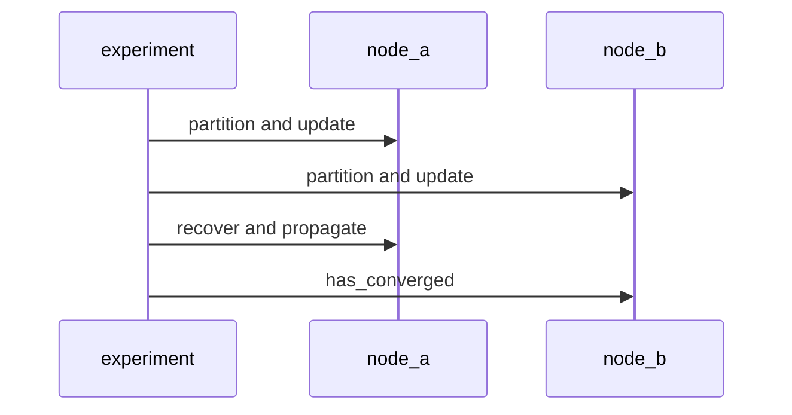
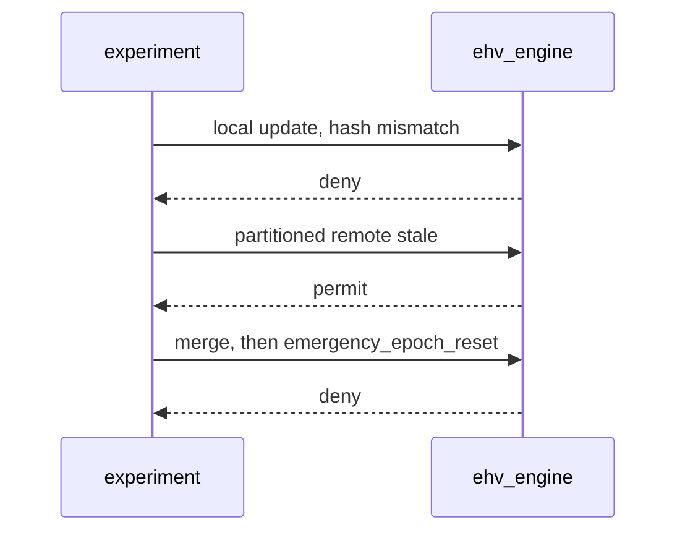
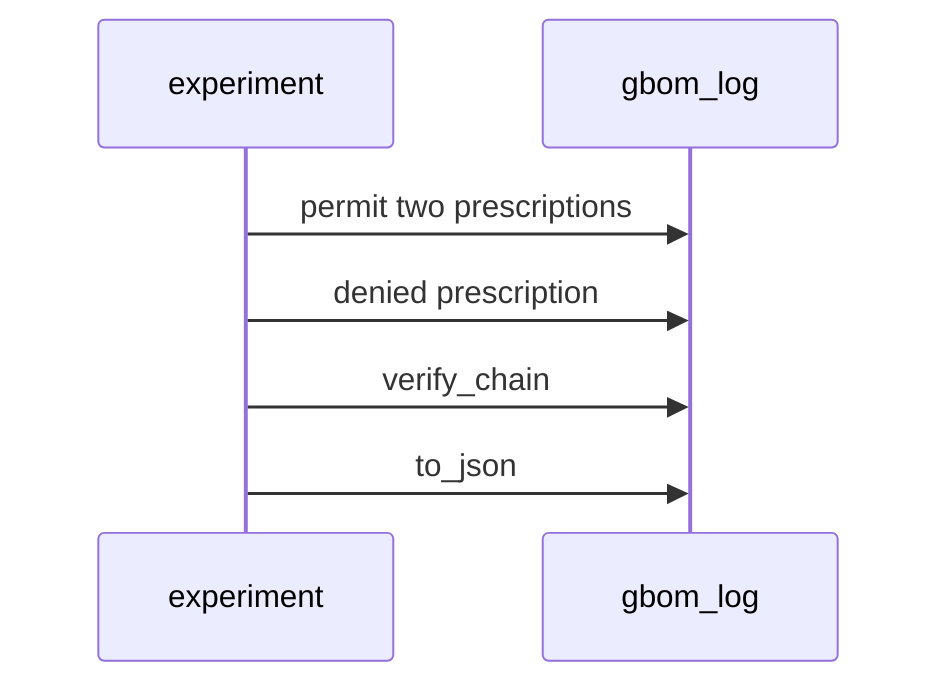

# Functional Workflows

## Actors

- Agent or application developer: decorates functions with the policy enforcement point. [I]
- Researcher: runs bench, experiments and examples scripts (bench/measure_enforcement.py:122, experiments/gbom_audit.py:20) [C]
- LLM (Anthropic API): proposes tool calls in the red-team example (examples/anthropic_redteam.py:97) [I]
- Verifier: runs the TLC model checker over EHV.tla (EHV.tla:46) [I]

## Capabilities

- Enforce PERMIT, DENY or ESCALATE on decorated calls (ehv/compiler/engine.py:113) [C]
- Attest policy epochs through a simulated enclave (ehv/enclave/enclave.py:8) [C]
- Converge policy across nodes by LWW or vector clocks (ehv/sync/store.py:28) [C]
- Mask logits by grammar-constrained decoding (ehv/gcd/masker.py:23) [C]
- Record a hash-chained GBOM audit log (ehv/compiler/gbom.py:125) [C]
- Measure enforcement latency (bench/measure_enforcement.py:122) [C]

## Workflows

### Action enforcement (formal model)
`ckb:workflow:action-enforcement-formal-model`
- **Trigger:** agent submits action. Inputs: action class, epoch validity. Outputs: PERMIT, DENY or ESCALATE.

Source: EHV.tla:70 [I]

1. SubmitAction records the action. [I]
2. Enforce picks the status from epoch validity and action class (EHV.tla:77) [C]
3. CompleteAction resets state. [I]

### Measure PEP enforcement latency
`ckb:workflow:measure-pep-enforcement-latency`
- **Trigger:** `python bench/measure_enforcement.py`. Output: actual_enforcement_latency.csv.

Source: bench/measure_enforcement.py:9 [C]

1. Build PolicyStore, Enclave, GBOMLog, EHVEngine (bench/measure_enforcement.py:122) [C]
2. Time 10000 calls per outcome. [C]
3. Write the CSV under bench/output (bench/measure_enforcement.py:87) [C]

### Synthetic SEV-SNP latency projection
`ckb:workflow:synthetic-sev-snp-latency-projection`
- **Trigger:** `python bench/sev_snp_benchmark.py`. Output: CSVs, plots, summary.

Source: bench/sev_snp_benchmark.py:25 [C]

1. Generate seeded Gaussian latency per scenario (bench/sev_snp_benchmark.py:25) [C]
2. Write outputs to bench/output (bench/sev_snp_benchmark.py:13) [C]

Values are synthetic, not measured on SEV-SNP hardware. [I]

### Governed action enforcement
`ckb:workflow:governed-action-enforcement`
- **Trigger:** call of a function decorated with EHVEngine.enforce. Output: action result or GovernanceError.

Source: ehv/compiler/engine.py:113 [C]

1. Verify epoch, or attest via enclave (ehv/compiler/engine.py:58) [C]
2. Read policies from the store (ehv/compiler/engine.py:5) [C]
3. Evaluate the constraint (ehv/compiler/engine.py:141) [C]
4. Append a hash-chained GBOM entry (ehv/compiler/gbom.py:127) [C]

### Red-team agent tool call enforcement
`ckb:workflow:red-team-agent-tool-call-enforcement`
- **Trigger:** `python examples/anthropic_redteam.py`. Requires ANTHROPIC_API_KEY (examples/anthropic_redteam.py:94) [C]

Source: examples/anthropic_redteam.py:144 [I]

1. LLM returns tool_use (examples/anthropic_redteam.py:157) [I]
2. Decorator checks dosage policy (examples/anthropic_redteam.py:130) [C]
3. Attestation fail-closed check (examples/anthropic_redteam.py:234) [I]

### CRDT partition/recovery convergence
`ckb:workflow:crdt-partition-recovery-convergence`
- **Trigger:** run experiments/crdt_convergence.py.

Source: experiments/crdt_convergence.py:15 [C]

1. Register two PolicyStore nodes, partition, update independently. [C]
2. Queue propagation, recover, check has_converged (experiments/crdt_convergence.py:53) [C]

### Epoch staleness scenarios
`ckb:workflow:epoch-staleness-scenarios`
- **Trigger:** run experiments/epoch_staleness.py.

Source: experiments/epoch_staleness.py:19 [C]

1. Local update causes hash mismatch, so deny. [C]
2. Partitioned remote with a stale epoch permits. [C]
3. Merge then deny; emergency_epoch_reset deny (experiments/epoch_staleness.py:123) [C]

### GBOM audit trail
`ckb:workflow:gbom-audit-trail`
- **Trigger:** run experiments/gbom_audit.py.

Source: experiments/gbom_audit.py:23 [C]

1. Set policy, permit two prescriptions, deny one. [C]
2. verify_chain, then dump to_json (experiments/gbom_audit.py:38) [C]

## State machines

Enforcement status is one of PERMIT, DENY, ESCALATE (EHV.tla:77) [C]. Epoch state: valid, expired, re-attested after duration or hash mismatch (ehv/compiler/engine.py:58) [C]. SVID: valid until revoked or TTL expiry (ehv/identity/workload.py:43) [C].

## Error and edge handling

- Constraint exception: logged ESCALATE and re-raised (ehv/compiler/engine.py:141) [C]
- Invalid or unreachable attestation: GovernanceError (ehv/compiler/engine.py:131) [C]
- Stale LWW update ignored (ehv/sync/store.py:28) [C]
- Partitioned stale permits within the window (experiments/epoch_staleness.py:141) [I]
