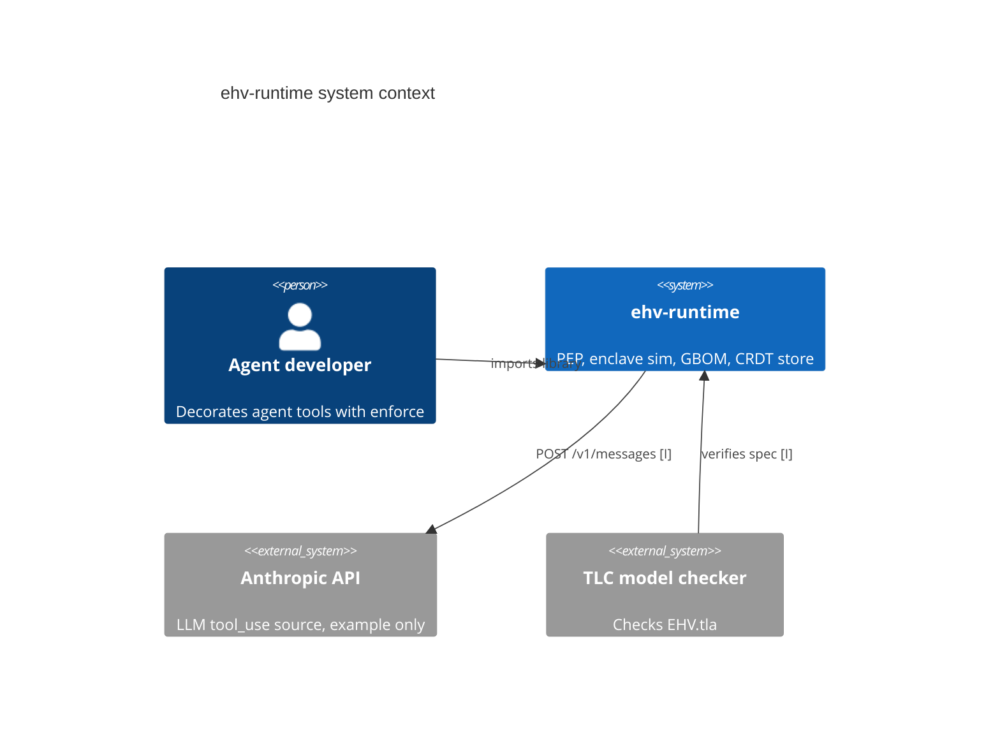

# System Context and Gaps

## System context (C4 L1)

ehv-runtime is a stdlib-only Python library (v0.3.0) that enforces policy on agent actions: it permits, denies or escalates each action, and it logs every decision to a hash-chained audit log (pyproject.toml:6, pyproject.toml:22) [C]. The repo owns the policy enforcement point, the simulated enclave, grammar-constrained decoding, the CRDT policy store, the SPIFFE identity stub and the GBOM log. It delegates LLM inference to an external API, used only by one example, and formal checking to TLC (EHV.cfg) [I].

Source: examples/anthropic_redteam.py:97, EHV.tla:46, pyproject.toml:6 [I]

## Contracts exposed

| Contract | Kind | Symbol | Source | Confidence |
|---|---|---|---|---|
| Governed action decorator | Python library | `ehv.compiler.engine.EHVEngine.enforce` | ehv/compiler/engine.py:113 | [C] |
| Logit masking | Python library | `ehv.gcd.masker.mask_logits` | ehv/gcd/masker.py:23 | [C] |
| SVID manager | Python library | `ehv.identity.workload.SVIDManager` | ehv/identity/workload.py:25 | [C] |
| Latency benchmark CLI | script | `run_actual_benchmarks` | bench/measure_enforcement.py:122 | [C] |
| SEV-SNP projection CLI | script | `sev_snp_benchmark` | bench/sev_snp_benchmark.py:1 | [I] |

No HTTP routes, events or RPC endpoints were found in any scope [C] (see the scout `checked` notes for root, ehv, bench and examples).

## Contracts consumed

| Contract | Kind | Source | Confidence |
|---|---|---|---|
| Anthropic Messages API `POST /v1/messages` at api.anthropic.com | outbound HTTP, example only | examples/anthropic_redteam.py:97, examples/anthropic_redteam.py:157 | [I] |
| `ANTHROPIC_API_KEY` env var | secret config | examples/anthropic_redteam.py:94 | [C] |
| pandas, matplotlib (optional `bench` extra) | PyPI | pyproject.toml:25 | [C] |

The core package has no runtime dependencies (pyproject.toml:22) [C].

## Assumptions

- The enclave is a simulation. It uses a shared-memory file and a hardcoded root key, not real TEE hardware (ehv/enclave/enclave.py:20, ehv/enclave/enclave.py:24) [C].
- SEV-SNP latency numbers are synthetic seeded Gaussian draws, not measurements of real hardware (bench/sev_snp_benchmark.py:25) [C].
- The TLA+ spec models enforcement abstractly and is not generated from the Python code (EHV.tla:70) [I].
- Callers supply the `constraint_func`, so the correctness of an enforcement result depends on it (ehv/compiler/engine.py:141) [C].

## Risks and tech debt

- Hardcoded simulated enclave root key in source, so attestation provides no real secrecy (ehv/enclave/enclave.py:24) [C]. See the 06 findings.
- Hardware root of trust is only simulated. The "hardware-rooted" claim in the package description is not realised in code (pyproject.toml:11, ehv/enclave/enclave.py:8) [I].
- Several rule statements come from experiment narratives (epoch staleness, GBOM chain, LWW convergence) rather than assertions in tests (experiments/epoch_staleness.py:141, experiments/gbom_audit.py:38) [I].
- The dosage limit is inconsistent across the examples (1.5 vs 0.75) and the experiments (default 10.0) (examples/clinical_dosage.py:11, experiments/gbom_audit.py:12) [I].
- ehv/sync/vclock.py and the examples/gcd_dosage.py and examples/latency_bench.py scripts were not scanned for rules (ehv/sync/vclock.py:1) [?].
- No CI configuration exists in the repo, so no automated gate runs the tests or the TLC model check [?].

## Open questions

| ID | Question | Why it matters | Where to look |
|---|---|---|---|
| Q-causal-store-rules | What rules does `CausalPolicyStore` and vclock enforce beyond LWW? | Conflict resolution is not fully covered by rules | ehv/sync/vclock.py:1 [?] |
| Q-ci-pipeline | Is there a CI or release process (PyPI publish)? | Determines the deploy and rollback story | pyproject.toml:6 [?] |
| Q-tla-conformance | Is the Python engine checked against EHV.tla? | Safety invariant is proven on the model only | EHV.tla:46 [?] |
| Q-real-tee-plan | Is a real SEV-SNP or SGX backend planned? | Trust claims depend on it | LIMITATIONS.md:1 [?] |
| Q-test-coverage | What do the tests assert for vclock, identity and oscal? | Rule traceability needs test mapping | tests/test_engine.py:1 [?] |
